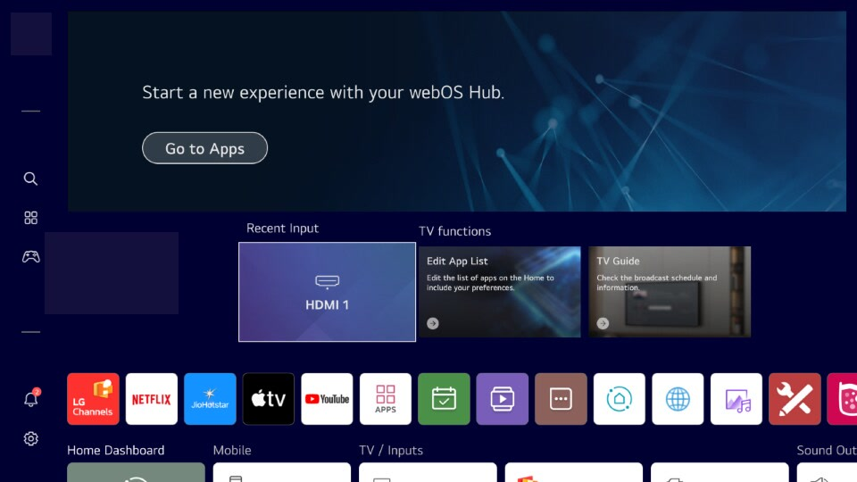
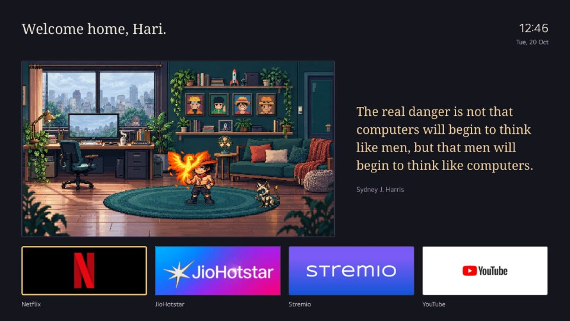
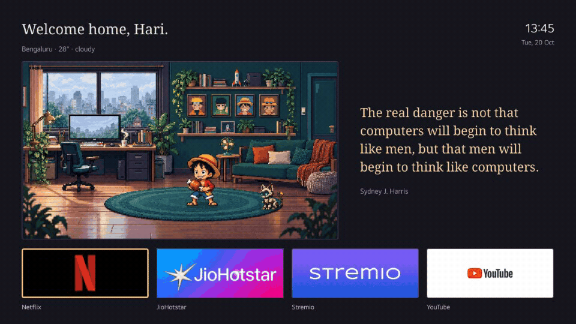

# webOS Home

A small native Home screen for rooted webOS. An animated pixel room, a clock,
a quote, and four app shortcuts replace the stock shelves. The existing Home
process still handles the remote and app launches.

## Before and after

| Stock webOS Home | Custom native Home |
| --- | --- |
|  |  |

Same TV and native Home process. The hardware badge is covered in the stock
capture.

## Animated demo



The demo cycles through all four character scenes and keeps the rotating
greeting and Bengaluru weather visible, with the owner's permission.

[Watch the device demo](media/home-demo.mp4) ·
[Before and after](docs/comparison.md) · [Setup](docs/setup.md) ·
[Root access](docs/root-access.md) · [Tailscale](docs/tailscale.md)

This repository is a worked example and a set of tools for adapting it. Point
your coding agent at [AGENTS.md](AGENTS.md), give it your device's webOS version,
and ask it to inspect compatibility before it installs anything.

## Tested platform

| Item | Tested value |
| --- | --- |
| Platform | webOS Hub22 |
| SDK | 7.5.9-36 |
| Firmware | 04.56.75 |
| Kernel and architecture | Linux 5.4.96, aarch64 |
| UI integration | `MainView_WEE.qml` in `com.webos.app.home` |
| Remote administration | Root SSH and Tailscale SSH |

The scripts check the Home binary and stock QML hashes before changing the
view. A matching product name or SDK number alone is insufficient. A new
firmware version needs its own inspection and test.

The platform above ran the original deployed UI. The extracted public
installer has local failure-path tests; its companion helpers passed device
checks. It has not had a fresh end-to-end deployment. Keep that distinction
when adapting it.

## Current installation

As of 20 October 2026, the original TV is rooted and enrolled in the owner's
Tailscale network as its own node. Tailscale SSH is enabled. A fresh root
login over the tailnet passed, and the node reported online. Persistent node
state and boot startup are already configured. The separate LAN recovery SSH
channel remains available.

Root came through an installed overlay app and the JavaScript service
launcher, followed by Homebrew Channel installation. The
[root history](docs/root-access.md#how-this-system-obtained-root) records the
exact mechanism, payload revision and hashes, failed alternative, persistence
repair, and verification. The
[Tailscale status and setup](docs/tailscale.md#current-installation-status)
records enrollment, SSH, storage, boot behavior, and remaining test limits.
Device names, network addresses, account details, and credentials stay private.

## What changes

The installer places the replacement QML and assets under
`/media/developer/native-home`. A bind mount covers one firmware QML file.
The firmware file and Home executable stay intact. Rollback disables the
owned startup hook, removes the mount, and restarts Home.

The public installer starts with a timed trial. It installs a permanent boot
hook only after you inspect the screen and confirm the result. Rooting and
Tailscale enrollment are separate steps. It does not remove applications or
disable services on your behalf.

The UI supports remote focus, app launch, a full-room view, Play/Pause for
motion, and optional weather. Personal greetings, weather coordinates, app
IDs, and artwork can be set in an ignored local config. The default has no
personal names and makes no weather requests. The demonstration uses the
owner's personalised theme.

## Start here

Install Python 3.10+, OpenSSH, Bun, and Node.js 20+ on your computer. The TV needs a working
root shell before the deployment tools can help.

```sh
bun install --frozen-lockfile
bun run verify
mkdir -p .local
cp config.example.json .local/config.json
```

Set the SSH host, private key path, and verified host key in your local
configuration. Keep the supplied profile only if the target hashes match.
Then follow [the setup guide](docs/setup.md). It covers the backup, timed
trial, visual check, activation, and rollback in order.

For a preview of the files without a TV connection:

```sh
python3 scripts/webos.py --config config.example.json build
```

For access from another network, follow [the Tailscale guide](docs/tailscale.md).
The TV runs its own node. It needs no gateway computer or public SSH port.

## Results and limits

The original matched comparison measured Home at 67.42 MiB PSS for stock and
50.20 MiB for the animated replacement. This saved 17.23 MiB, or 25.6%, for
that process. Animation used 2.98% of one core versus 0.10% for idle stock
Home. The later sprite revision measured 46.79 MiB and 1.59% of one core in a
separate run. These measurements do not establish a whole-TV speedup.

Remote standby wake worked with Quick Start+ and Home autolaunch enabled.
A full wall-power boot can still show stock Home before the late startup
mount. Playback, HDMI, audio, power use, and long-term stability have not been
fully tested. A Home backup is not a firmware image or an offline unbrick
method. See [the comparison and measurement notes](docs/comparison.md).

## Contributing and licensing

Small fixes, new verified firmware profiles, and clearer recovery instructions
are welcome. Read [CONTRIBUTING.md](CONTRIBUTING.md) before submitting a device
profile. Use [SECURITY.md](SECURITY.md) for private vulnerability reports.

Source code and documentation use the [MIT license](LICENSE). Existing sample
art and demonstration captures have additional character and trademark
considerations in [NOTICE.md](NOTICE.md).
