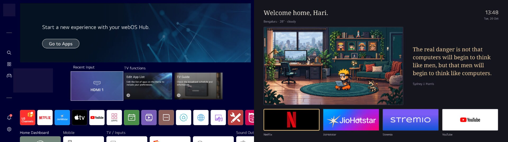

# Stock and replacement Home

These are actual display captures. The stock image has its hardware badge
covered. The new image retains the greeting and Bengaluru weather line with
the owner's permission. The optional sample theme and app logos are shown
under the [artwork notice](../NOTICE.md).

| Area | Stock Home | Replacement |
| --- | --- | --- |
| Main view | Shelves, input cards, application row | Pixel room, clock, quote, four app shortcuts |
| Runtime | Existing native Home process | Same process, one replacement QML view |
| App integration | Firmware launcher | Existing native application interface |
| Animation | Stock transitions and cards | Sprite atlases, fan, steam, cat, optional characters |
| Motion control | Firmware behavior | Play/Pause; animation stops when Home is hidden |
| Recovery | Stock firmware view | Disable owned hook and unmount replacement |
| Full boot | Stock view | Can briefly show stock before webOSbrew starts |

[Device demo, MP4](../media/home-demo.mp4) ·
[Animated preview, GIF](../media/home-demo.gif) ·
[Full-room preview](../media/room-demo.mp4)

The dashboard demo shows all four character scenes: Naruto, Might Guy, Luffy,
and Ace. It uses captured frames and compresses the real greeting cycle for
viewing. Hari is visible in 60% of dashboard frames, with Adi and Aadith in
the remaining frames. Every dashboard frame retains a name and the actual
Bengaluru temperature and weather condition. The owner approved these details
for publication. The full-room clip shows a separate actual-device capture.
These clips do not measure display frame rate or app readiness.

## Measurements from the original project

One matched restart pair on webOS Hub22, SDK 7.5.9-36, firmware 04.56.75,
measured the following. Each state used three consecutive roughly ten-second
windows on the same boot, with the same background apps.

| Home state | Median Home PSS | Median CPU, one core |
| --- | ---: | ---: |
| Stock, idle after restart | 67.42 MiB | 0.10% |
| Replacement, animated after restart | 50.20 MiB | 2.98% |

That is a 17.23 MiB difference, or 25.6% of stock Home's PSS. The replacement
was deliberately animating while stock was idle. On this four-core device,
2.98% of one core is about 0.745% of total CPU capacity. These values are for
Home, not the whole television or its GPU.

The pair used an earlier animation renderer. The later sprite-sheet version
measured 46.79 MiB PSS, zero SwapPss, and 1.59% of one core over three further
ten-second windows. It was not another matched stock comparison. Do not
calculate a new savings percentage by combining the two runs. The final
quote and public installer have not had a new matched performance test.

An earlier same-process pause test dropped Home to about 0.10% of one core.
The sprite revision's paused room pixels were identical across two display
captures. Tailscale adds separate memory use, roughly 20 to 35 MiB PSS across
the recorded states. None of these tests establishes a faster full boot.

## App switching

| App | First switch in sequence | Warm reopen median | Return to Home median |
| --- | ---: | ---: | ---: |
| Netflix | 1.896 s | 0.721 s | 0.521 s |
| JioHotstar | 5.387 s | 0.277 s | 0.447 s |

The endpoint was the foreground-app API. It did not measure the first visible
frame, interactive readiness, or playback. The close request returned access
denied, so the first switch is not a verified cold launch. Warm reopen used
three trials and return used four. Stremio launch and return passed later;
account linking and playback were not completed by this repository release.

## Cleanup and limits

The original device project removed selected user-installed apps and disabled
confirmed optional content analysis and diagnostic uploading. It retained
core input, Bluetooth, HDMI, networking, voice dependencies, and DRM services.
Those operations are not part of this installer. Many firmware app records
are integration entries, not resident processes. Deleting files in read-only
firmware would not free the writable app partition.

Quick Start+ and Home autolaunch passed a remote standby-wake test. A wall-power
boot remained slower and could expose stock Home. Long-term memory growth,
audio, HDMI, playback, GPU use, standby power, and an offline unbrick procedure
were not fully tested. Raw session transcripts, account screens, firmware
backups, and inventories are excluded from this public repository. The table
above is a sanitised report of the original measurements, not a new benchmark
suite or a compatibility promise.
