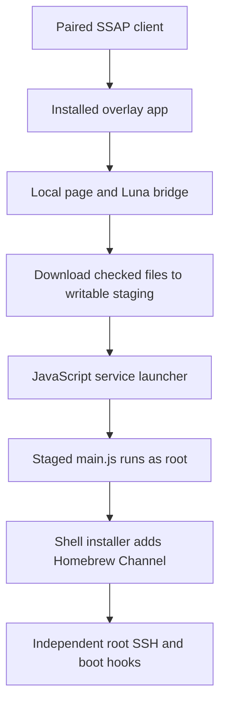

# Root access and recovery

The Home replacement needs an existing root shell. Developer Mode's `prisoner`
shell is insufficient. This project was tested on webOS Hub22, SDK `7.5.9-36`,
firmware `04.56.75`, with an aarch64 Linux `5.4.96` kernel. These version numbers
describe one tested system. They do not establish compatibility with another TV.

Check your exact firmware against the
[webOS Homebrew rooting guide](https://www.webosbrew.org/rooting/) before choosing
an access method. Homebrew Channel can also run without root, so its presence
alone does not prove that root works.

## How this system obtained root

The successful method used the JavaScript service launcher. The earlier attempt
through `com.webos.service.legacybroadcast.debug/menu` did not establish root.
A successful Luna response from that endpoint was insufficient proof.

The successful sequence was:

1. Record the firmware version and retain the existing Developer Mode connection.
   Pair the computer with the TV's SSAP control service through its on-screen
   approval prompt. Keep the resulting client key private.
2. Inspect the published installer and pin its source revision. Verify the hashes
   of `index.html`, `autoroot.sh`, `package.json`, and `main.js` before serving
   them. The tested installation used those four files unchanged.
3. Start a temporary HTTP server on the trusted LAN. Launch the installed
   `com.webos.app.dangbei-overlay` application through SSAP with a `target` URL
   pointing to the page. Confirm that the TV downloaded all four expected files.
4. The page staged a fake JavaScript service package and called
   `com.webos.service.jsserver/run` with the fake service path
   `/usr/palm/services/com.palm.service.devmode`. On this firmware, the launcher
   ran the staged package's `main.js` as UID 0. That script ran the installer.
5. The installer added Homebrew Channel and its root startup support. Verify UID
   and capabilities through the new root channel. The old `prisoner` connection
   can remain unprivileged even after installation succeeds.
6. Enable root SSH, install your own public key, and prove an independent login.
   Stop the temporary HTTP server. Check persistence before changing Home.

This is a record of the working mechanism, not a universal rooting command.
The installer payload is not distributed here. Obtain a method that supports
your firmware from its upstream project, review it, and retain its license and
provenance. Do not invent payload bytes from the description above.

### Payload identity

The original installation ran on 19 October 2026. It used the published
installer at source revision
`21023d56ca424607bb03d2939609cc658c655fc7`. The local runner checked these
SHA-256 hashes before serving any bytes:

| File | SHA-256 |
| --- | --- |
| `index.html` | `0430d93c45885de73ba5f3e2f32b1e4ef9e713234de818162f0cb8ac20a1ff36` |
| `autoroot.sh` | `16bedff5ee8f8c754e6e302e3251dfc904f6aa7ca71c0b0483f7e5fc6bbb3611` |
| `main.js` | `3a6830ac858bb71f0bd0b9f45514ff1fd85d707170f59941e6771d454102f791` |
| `package.json` | `f573657cb5db54fd8b0f724ae69d8f8fd6903ec6ca0f038ce2b47e4f45ef1ef0` |

These hashes identify the bytes used in this project. They do not establish
that a payload is safe or compatible with another firmware. The upstream
payload uses AGPL-3.0-or-later. This repository's MIT license does not relicense
that payload, and the payload is not bundled here.

### Launch and privilege transition

The computer served only the four checked files through a temporary LAN HTTP
server. It reused the owner's existing paired SSAP connection on port 3001.
The launch request selected `com.webos.app.dangbei-overlay` and passed the page
URL in `params.target`. The URL had this form, with the actual address and port
kept private:

```text
http://COMPUTER_LAN_HOST:PORT/index.html?script=autoroot.sh&files=package.json;main.js&fake-service-path=/usr/palm/services/com.palm.service.devmode
```

The request shape was:

```json
{
  "type": "request",
  "id": "launch-root-page",
  "uri": "ssap://system.launcher/launch",
  "payload": {
    "id": "com.webos.app.dangbei-overlay",
    "params": {
      "target": "http://COMPUTER_LAN_HOST:PORT/index.html?script=autoroot.sh&files=package.json;main.js&fake-service-path=/usr/palm/services/com.palm.service.devmode"
    }
  }
}
```

This documents the original request. It requires the separately reviewed
upstream files, the installed overlay app, a paired client, and compatible
firmware. The public Home helper's simple `launch` command does not take this
parameter object or perform rooting.

The overlay page had access to the Luna service bridge. It used
`com.webos.service.downloadmanager/download` to place the shell script and fake
JavaScript package in `/media/internal/downloads`. Each download had to finish
before the page requested service execution. The package declared the name
`com.webos.service.jsserver` and selected `main.js` as its entry point.

The page then called `com.webos.service.jsserver/run`. Its supplied arguments
combined the fake service path, the staged package directory, and the shell
script path. The service launcher executed that staged JavaScript with root
privileges on this firmware. The JavaScript invoked `/bin/sh` with the staged
installer. The installer referenced Homebrew Channel 0.7.3, installed it, and
elevated its service so later administration did not require the temporary page.



The privilege transition occurred in the service launcher. An open Developer
Mode shell or an app-launch acknowledgement did not prove it. The proof came
from a separate root session, its UID and capability mask, the installed root
service, and subsequent reboot checks. The temporary server was stopped after
installation. Completed installer staging was later archived locally and
removed from the TV. It is not a resident daemon.

### Why the earlier route failed

The earlier broadcast-debug method returned `returnValue: true`, but its
first expected file-mode change did not occur. Its log was absent, Homebrew
Channel was absent, and no root listener appeared. Those observations showed
that the API acknowledgement did not establish command execution on this
firmware. The later JavaScript service route crossed a different privilege
boundary and produced independently verified root access.

## Installed administration components

| Component | Location or behavior |
| --- | --- |
| Homebrew Channel service | `/media/developer/apps/usr/palm/services/org.webosbrew.hbchannel.service` |
| Boot activity | Starts Homebrew Channel through the activity manager |
| Startup script | `/var/lib/webosbrew/startup.sh` |
| Owner boot hooks | `/var/lib/webosbrew/init.d/` |
| LAN root SSH | Homebrew Channel's Dropbear server, port 22 |
| Root public-key authorization | `/home/root/.ssh/authorized_keys` |
| Restricted Developer Mode SSH | `prisoner` on port 9922, separate from root |
| Remote root SSH | Tailscale SSH on the enrolled TV node |

Only public keys belong in the TV's authorization file. Private recovery keys
remain on the owner's computer. Tailscale enrollment and its current verified
status are recorded in [tailscale.md](tailscale.md#current-installation-status).

Homebrew Channel declares a Luna root-execution endpoint. Calls made during
this project returned empty output without an independently verified effect.
The endpoint's existence is not a tested replacement for the working SSH
recovery channels.

## Verify the root shell

Run these in the new root shell:

```sh
id
awk '/^(Uid|CapEff):/ {print}' /proc/self/status
cat /proc/uptime
uname -r
```

The tested result included `uid=0(root)` and
`CapEff: 0000003fffffffff`. Compare the firmware and host identity with your own
private baseline before installing anything. Do not copy this project's original
device identifiers into your configuration.

Homebrew Channel documents a root execution API and executable startup hooks in
`/var/lib/webosbrew/init.d/`. It also documents key-based SSH configuration in
`/home/root/.ssh/authorized_keys`. Follow its
[rooted-device setup instructions](https://github.com/webosbrew/webos-homebrew-channel#configuring-webososeares-cli-with-rooted-tv).
Keep a LAN SSH login available while testing Home and Tailscale.

## Root and read-only firmware

Root can write persistent storage and create mounts. It cannot make every
firmware filesystem writable.

| Path on the tested system | Result |
| --- | --- |
| `/var`, `/home`, `/media/developer`, `/media/internal` | Writable |
| `/mnt/lg/cmn_data`, `/mnt/lg/user`, `/mnt/lg/appstore` | Writable |
| `/tmp` | Writable, cleared at reboot |
| `/`, `/usr`, `/etc`, `/bin`, `/lib`, `/opt` | Read-only |

The `/usr` overlay had no writable upper directory. A file bind mount and a
separate overlayfs mount both worked. This project keeps its replacement under
`/media/developer/native-home` and bind-mounts the selected QML file. It does not
rewrite the firmware image.

## Preserve the root installation

On this firmware, `/lib/systemd/system/scripts/devmode.sh` deletes
`/media/developer` when `/var/luna/preferences/devmode_enabled` is absent.
The root installer created that marker as a directory. The installed Developer
Mode app tried to read it as a session token, failed, and removed it during the
first reboot. A subsequent boot could then erase the root installation.

The tested repair recreated the directory, set its immutable attribute, and
installed a startup hook. This applies to the observed directory marker. Do not
replace a normal Developer Mode token file with a directory on an unrooted TV.
Do not print the contents of an existing token file.

Inspect the marker and boot scripts before applying the repair. If the marker is
a directory, these were the repair commands:

```sh
test -d /var/luna/preferences/devmode_enabled || exit 1
chmod 755 /var/luna/preferences/devmode_enabled
chattr +i /var/luna/preferences/devmode_enabled
lsattr -d /var/luna/preferences/devmode_enabled
```

If this exact failure already removed the marker, recreate it with `mkdir -p`
only after confirming the root installer expected a directory there. Do this
before another reboot. Stop if the firmware or marker type differs.

The tested `/var/lib/webosbrew/init.d/00-keep-devmode-flag` contained:

```sh
#!/bin/sh
mkdir -p /var/luna/preferences/devmode_enabled
chmod 755 /var/luna/preferences/devmode_enabled
```

It was root-owned and executable. The immutable attribute prevented deletion;
the hook alone was not the protection. Do not clear the attribute or remove the
marker during routine Home rollback. Avoid reinstalling Developer Mode over a
root installation. Homebrew Channel provides the replacement development access.

## Prove persistence and recovery

Before activating a replacement Home:

1. Back up stock Home and its hash locally. Run the repository's `check` and
   `backup` commands with your private configuration.
2. Confirm a fresh root SSH login without relying on the original open session.
3. Perform a software reboot. Reconnect without manually starting root services.
   Recheck UID, capabilities, the marker type and immutable attribute, and Home.
4. Perform a real cold boot when the owner is ready. Remote standby can retain
   processes and is insufficient for this check. Repeat the same checks.
5. Test Home rollback over the independent SSH channel before calling it done.

The original root installation passed two reboot tests. The session called them
cold reboots, but the command record includes software `reboot`, so it does not
prove two physical power cycles. Every new device needs its own boot and recovery
tests.

Homebrew Channel documents a startup failsafe and optional telnet recovery.
Telnet is unauthenticated. Keep it on a trusted LAN and verify the channel before
depending on it. A declared Luna endpoint with empty output is also insufficient
proof of recovery. See the
[Homebrew Channel recovery behavior](https://github.com/webosbrew/webos-homebrew-channel#features).

If `/media/developer` is empty or root SSH is unavailable, restore access before
attempting Home deployment. The public Home tools assume root already works.
